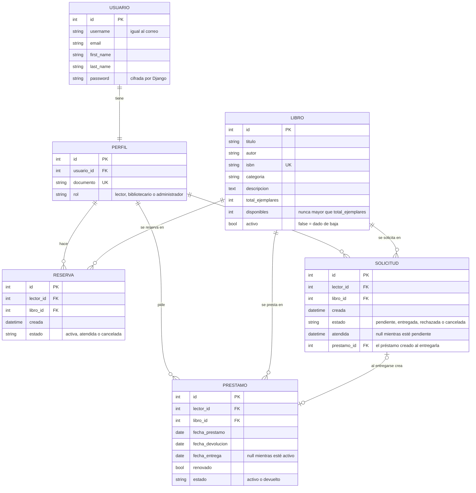

# Modelo de datos (T-02)

Issue: [#2 · T-02 Diseñar el modelo de base de datos](https://github.com/FelipeNavarrete0313/bibliotrack/issues/2)

## Diagrama entidad-relación



## Decisiones de diseño

| Decisión | Por qué |
| --- | --- |
| Se usa el usuario de Django y un `Perfil` aparte | Django ya resuelve contraseñas cifradas y sesiones; el perfil guarda lo propio de BiblioTrack (documento y rol). |
| El correo es el nombre de usuario | La historia HU-02 pide iniciar sesión con correo y contraseña. |
| Los ejemplares son una cantidad en `Libro` (`total_ejemplares` y `disponibles`) | Ninguna historia necesita distinguir un ejemplar físico de otro. Si eso cambia, se crea una tabla `Ejemplar`. |
| `disponibles <= total_ejemplares` es una restricción de la base de datos | El error se detecta aunque alguien se salte la aplicación. |
| Un libro dado de baja no se borra (`activo = false`) | HU-08 pide conservar su historial de préstamos. |
| El préstamo guarda `fecha_devolucion` y `fecha_entrega` por separado | HU-10 necesita calcular los días de retraso. |
| La `Solicitud` (HU-17) es una tabla aparte y no descuenta ejemplares | El lector pide el libro en línea, pero el ejemplar solo sale al entregarlo; ahí se crea el `Prestamo` con las reglas de HU-09. Se agregó en la migración `0002_solicitud`. |

## Script SQL

Django crea las tablas con migraciones (`biblioteca/migrations/`). El SQL equivalente está en [`sql/esquema.sql`](sql/esquema.sql) y se generó con:

```bash
py manage.py sqlmigrate biblioteca 0001
py manage.py sqlmigrate biblioteca 0002
```

## Datos de prueba

`py manage.py cargar_datos` crea 20 libros en 7 categorías y 5 usuarios. Todos usan la contraseña `Biblio2026`.

| Correo | Documento | Rol |
| --- | --- | --- |
| ana@bibliotrack.test | 1001 | Lector |
| carlos@bibliotrack.test | 1002 | Lector |
| laura@bibliotrack.test | 1003 | Lector |
| sofia@bibliotrack.test | 2001 | Bibliotecario |
| diego@bibliotrack.test | 3001 | Administrador |

Son datos inventados para el ambiente de desarrollo.
