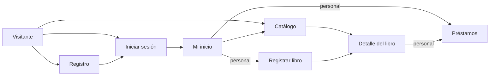

# Prototipos de interfaz (T-04)

Issue: [#4 · T-04 Diseñar los prototipos de interfaz](https://github.com/FelipeNavarrete0313/bibliotrack/issues/4)

Prototipos de baja fidelidad: muestran **qué hay en cada pantalla y dónde**, no colores ni tipografía. Cada pantalla indica la historia de usuario que la pide.

Reglas comunes a todas las pantallas:

- La barra superior cambia según quién está conectado: visitante, lector o personal de la biblioteca (bibliotecario y administrador).
- Ninguna pantalla enlaza al panel interno de Django. Todo se hace desde las páginas de BiblioTrack.

## 1. Inicio de sesión · HU-02

```
+--------------------------------------------------------------+
| BiblioTrack        Catálogo          Iniciar sesión  Registrarse |
+--------------------------------------------------------------+
|                                                              |
|   Iniciar sesión                                             |
|   +--------------------------------------------+             |
|   | Correo     [ ana@bibliotrack.test        ] |             |
|   | Contraseña [ ••••••••                    ] |             |
|   |                                            |             |
|   | [ Entrar ]                                 |             |
|   |                                            |             |
|   | ¿No tienes cuenta? Regístrate              |             |
|   +--------------------------------------------+             |
|                                                              |
|   Error: «Correo o contraseña incorrectos.»                  |
|   (no dice cuál de los dos falló)                            |
+--------------------------------------------------------------+
```

## 2. Registro de lector · HU-01

```
+--------------------------------------------------------------+
| BiblioTrack        Catálogo          Iniciar sesión  Registrarse |
+--------------------------------------------------------------+
|   Crear una cuenta                                           |
|   +--------------------------------------------+             |
|   | Nombre      [                            ] |             |
|   | Apellido    [                            ] |             |
|   | Documento   [                            ] |             |
|   | Correo      [                            ] |             |
|   | Contraseña  [                            ] |  mínimo 8   |
|   | Confirmar   [                            ] |             |
|   | [ Crear cuenta ]                           |             |
|   +--------------------------------------------+             |
|   Al terminar: vuelve a «Iniciar sesión» con el mensaje      |
|   «Tu cuenta fue creada. Ya puedes iniciar sesión.»          |
+--------------------------------------------------------------+
```

## 3. Mi inicio (según el rol) · HU-02

```
+--------------------------------------------------------------+
| BiblioTrack  Mi inicio  Catálogo  [Préstamos] [Nuevo libro]  Ana · Cerrar sesión |
+--------------------------------------------------------------+
|   Hola, Ana María                                            |
|                                                              |
|   Lector                       | Bibliotecario / Administrador|
|   +-------------------------+  | +-------------------------+  |
|   | Buscar libros           |  | | Registrar un préstamo   |  |
|   | Mis préstamos           |  | | Registrar un libro      |  |
|   +-------------------------+  | | Buscar libros           |  |
|                                | +-------------------------+  |
+--------------------------------------------------------------+
  [ ] = solo lo ve el personal de la biblioteca
```

## 4. Catálogo con buscador · HU-06

```
+--------------------------------------------------------------+
| BiblioTrack   Mi inicio   Catálogo                 Ana · Cerrar sesión |
+--------------------------------------------------------------+
|   Catálogo de libros                                         |
|   [ Busca por título o autor          ] [Todas ▼] [Buscar]   |
|                                                              |
|   Título                    Autor             Disponibilidad |
|   ---------------------------------------------------------- |
|   Cien años de soledad      G. García Márquez  3 disponibles |
|   El amor en los tiempos…   G. García Márquez  Agotado       |
|                                                              |
|   Sin resultados: «No encontramos libros con "xyz"…»        |
+--------------------------------------------------------------+
```

## 5. Detalle del libro · HU-07

```
+--------------------------------------------------------------+
|   ← Volver al catálogo                                       |
|   Cien años de soledad                                       |
|   +--------------------------------------------------------+ |
|   | Autor           Gabriel García Márquez                 | |
|   | ISBN            978-0307474728                         | |
|   | Categoría       Novela                                 | |
|   | Descripción     La historia de la familia Buendía…     | |
|   | Disponibilidad  2 de 3 ejemplares disponibles          | |
|   |                 (si está agotado: próxima devolución)  | |
|   +--------------------------------------------------------+ |
|   [ Registrar un préstamo ]   ← solo personal              |
+--------------------------------------------------------------+
```

## 6. Registrar un libro · HU-05 (solo personal)

```
+--------------------------------------------------------------+
|   Registrar un libro                                         |
|   Título*     [                              ]               |
|   Autor*      [                              ]               |
|   ISBN*       [                              ]  único        |
|   Categoría*  [                              ]               |
|   Descripción [                              ]               |
|   Ejemplares* [ 1 ]                                          |
|   [ Guardar ]                                                |
+--------------------------------------------------------------+
```

## 7. Préstamos · HU-09 (solo personal)

```
+--------------------------------------------------------------+
|   Préstamos                                                  |
|   Registrar un préstamo          | Préstamos activos         |
|   Documento del lector [      ]  | Libro    Lector   Devolver|
|   Libro [ Elige un libro    ▼ ]  | Clean…   Ana      24/11   |
|   [ Registrar préstamo ]         | Cosmos   Carlos   26/11   |
|   Devolución: 15 días; máx. 3    |                           |
+--------------------------------------------------------------+
```

## Flujo entre pantallas


